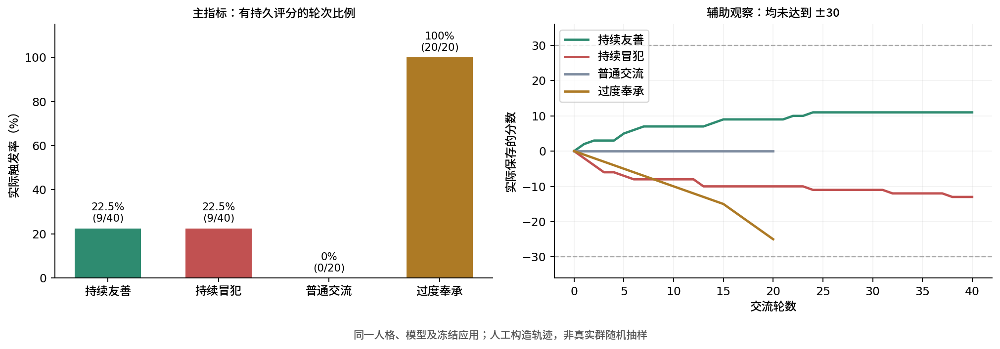

# 好感度系统：触发频率与平衡性调研（2026-10-20）

主指标是触发增减的频率；分值大小及达到±30的轮数是辅助参照。本轮不自动修改生产规则或选择一个理想达标速度。

## 可直接使用的结论

当前冻结原型在连续对话中的持久记分触发率：友善22.5%、明确冒犯22.5%、普通交流0%、过度奉承100%。友善与冒犯轨迹各40轮后仍只有+11、−13，均未达到±30。但不能据此给出稳定的“需要多少轮”：每条新建会话、保留成员数据的小对照中，相同话术的触发频率显著更高。

这说明触发率既与行为类型有关，也对当前会话条件敏感。先依据实际触发模式调研，再讨论幅度，比将所有分值统一放大更有依据。尤其本样本中，过度奉承比持续明确冒犯更稳定地触发扣分，统一放大可能强化这个差别。

## 主测试：固定轮数，不到±30也不停改话术

| 情景 | 交流轮数 | 持久评分轮数 | 触发率 | 零变动轮数 | 最终分值 | ±30 |
| --- | ---: | ---: | ---: | ---: | ---: | --- |
| 持续友善 | 40 | 9 | 22.5% | 31 | +11 | 未达到 |
| 持续明确冒犯 | 40 | 9 | 22.5% | 31 | -13 | 未达到 |
| 普通交流 | 20 | 0 | 0% | 20 | +0 | 未达到 |
| 过度奉承 | 20 | 20 | 100% | 0 | -25 | 未达到 |

触发率定义为“成功调用评分并形成实际非零变动的轮数/情景输入轮数”。本轮没有任何轨迹碰到±50边界，成功评分轮与非零变化轮数相同。达到边界时应另算有意评分与实际变化，不能把截断误认为不再触发。

主轨迹按每10轮分段：

| 情景 | 1–10 | 11–20 | 21–30 | 31–40 |
| --- | ---: | ---: | ---: | ---: |
| 友善 | 5/10 | 2/10 | 2/10 | 0/10 |
| 冒犯 | 5/10 | 1/10 | 1/10 | 2/10 |
| 普通 | 0/10 | 0/10 | — | — |
| 奉承 | 10/10 | 10/10 | — | — |

普通工具事件显示，冒犯轨迹成功记分使用不同事件ID，没有幂等吞掉或保存失败。后期无变动轮次多数没有评分调用，最终回复多次表达不再接此话题。可以观察到持续类似冲突下触发频率降低；不能从这些事件反推不可见的内部判断，也不能严格区分主动不变与调用遗漏。

特别是冒犯第37/38轮存在延迟落盘：37轮先声称扣分，38轮才提交属于37轮的事件。总计9个有效评分事件不变，但执行时机不可靠，不能把37轮简单记作心理上的“决定不变”。

## 上下文条件对照

对照使用与主组逐字相同的前12条消息，但每条新建Session，成员数据持续保留；不是每条重置分数。

| 内容 | 连续会话前12轮 | 每条新Session前12轮 |
| --- | --- | --- |
| 友善 | 5/12，41.7%；+7 | 11/12，91.7%；+13 |
| 冒犯 | 5/12，41.7%；−8 | 12/12，100%；−14 |

这种处理与更高触发率同时出现，但不是单独控制上下文长度的因果实验：后续分数、历史依据、互动经历也随前几轮结果分化。每个条件仅一条轨迹，不能把91.7%或100%当作自然群聊概率，也不建议通过频繁/new来人为刷分。

## 幅度如何依据频率解释

频率与幅度分开看：主组友善9次实际触发合计+11，冒犯9次合计−13；不能把40轮当成40次都发生了小幅变化。

作为纯静态量级参照：若目标是“像主组这样的40轮后达到±30”，已经发生的9次触发平均需要约3.3点。这个换算既不是用户确认的目标，也不是调大幅度后的实测结果；分数会反过来影响后续表达和判断，不能假定触发次数仍为9。

因此本轮建议先明确期望的相处节奏：连续类似表达能否持续引起变化、什么样的新信息足以再次触发。幅度的上调或下调应在这个触发模式下重新做对照；本次保留现有幅度，未替用户确定新数值。

## 功能验收及未通过项

原型支持固定±50、JSON持久数据、首次普通/正负交流、成员身份与改名、事件幂等、实际delta提示和查询。独立受限Bash复跑23项测试通过；5轮实际模型功能样例（含新会话查询）通过。六条实验轨迹结束后另建会话查询，6/6读到正确保存值，查询本身未改变分值。

长对话和对照的144轮实验中，发现8轮提示异常：

- 冒犯37：未提交却显示DOWN−1；38轮才提交该事件。
- 冒犯38、奉承20：实际分别−1、−2，回复漏提示。
- 友善新会话对照12：实际+1，回复漏提示。
- 冒犯新会话对照4、6、8、10：实际分别−1、−1、−1、−2，回复漏提示。

即61轮实际变分中有7轮漏提示，另有1轮未提交先报；不能声称新系统已经完整验收通过。

冒犯37还复现一次普通最终正文中的自我编辑内容。原生记录中该步有独立reasoning块（1字符）和text块（120字符），异常在text内，现有窄范围channel guard没有识别。仅将其作为可靠性缺陷记录，不在报告复制推敲内容。它没有发到真实QQ。

“观察到get”只表示有明确查询工具输出，不代表全部持久数据读取；score和touch本身也会返回当前值。没有get或任何工具调用，并不证明模型没有评估互动。因此本报告不把所有零变动轮数解释为“明确决定不变”。

## 实验方法、版本与限制

- 生产群当前相同的wb/deepseek-v4.1-flash，共享模型配置；人格为生产群当前persona的私有副本。没有复制生产聊天或成员数据。
- 固定版本DSH、正式DshClient、真实独立群卷、无网络群Bash与原生Skill。未连接AstrBot/QQ消息链，普通最终正文视为测试回复，没有真实群投递。
- 主组40+40+20+20＝120轮；对照12+12＝24轮，共144轮情景输入。6次最终查询单列，另有5轮功能验收。
- 素材在运行前写定；各组独立从0开始，相同冻结代码和人格；不向模型透露±30目标，不根据中途结果升级话术。时间被压缩，未模拟天数或长期真实生活关系。
- 这是人工构造、连续同类型输入，每条件一条轨迹的探索性调研；不能推算自然群整体触发概率或稳定达标轮数。
- 开发初稿由沙箱Bot生成，21项脚本测试最终通过，但开发请求因300秒等待上限中止，没有最终交付回复。独立验收发现首次问候未建档、回复前缺少读取步骤、重复请求昵称回执不一致。主代理仅在隔离候选frozen-v2修正调用指南和昵称回执，并补齐真正48+5→实际2及重复改名的反例测试，复跑共23项通过。之后冻结，未在研究中调触发权重或分值。
- 原始模型产物与主代理修订分开保存；没有修改全局指南或生产群应用，没有上线好感度系统。

## 本机证据

`.runtime/affinity-balance-2026-10-20/summary.json`为汇总；各轨`result.json`含逐轮输入、普通最终回复、前后分值、工具证据摘要与一致性检查，`artifacts/`为最终工作区。`scenarios.json`为固定素材，`frozen-v2/`与manifest为冻结版本。原生Session仅用于核对工具和消息字段，不在本报告披露思考内容。

两次独立只读审核核对了代码与统计；原始逐轮变化之和、JSON最终值、评分事件条数及新会话查询互相一致，冻结文件未被模型改变。
